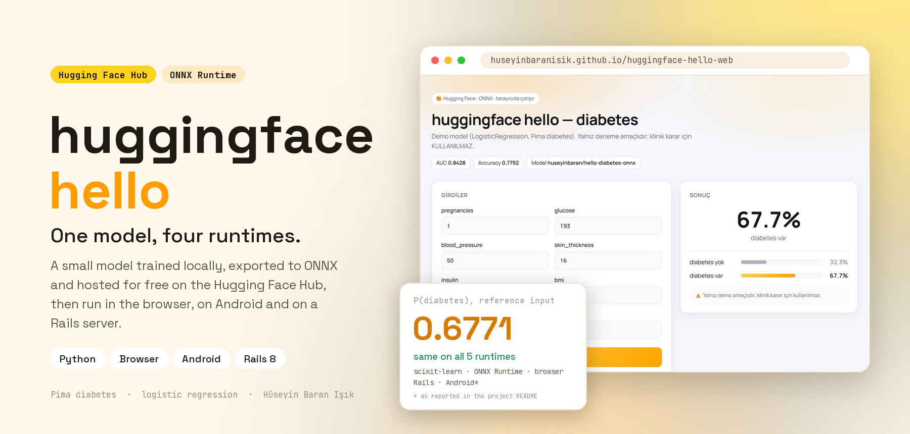
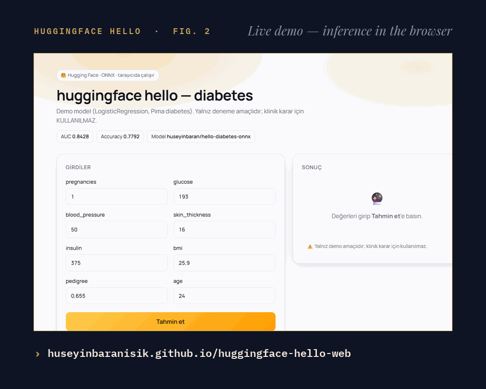
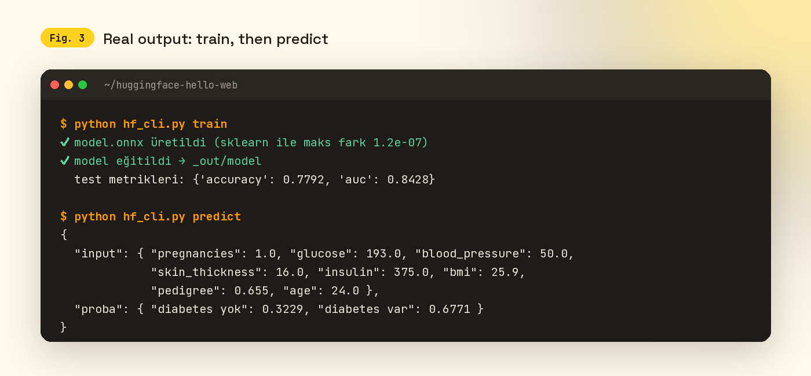
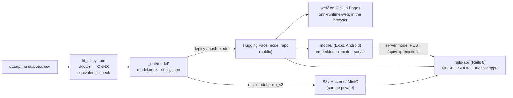

<p align="center">
  
</p>

<p align="center">
  <a href="#demo">Demo</a> &nbsp;·&nbsp;
  <a href="#how-it-works">How it works</a> &nbsp;·&nbsp;
  <a href="#run-it">Run it</a> &nbsp;·&nbsp;
  <a href="#contract">Contract</a> &nbsp;·&nbsp;
  <a href="#known-limits">Limits</a> &nbsp;·&nbsp;
  <a href="#türkçe">Türkçe</a>
</p>

An end-to-end example of publishing a tabular model **for free** and using it on the web, on
mobile and on a server, automated from the command line. The model is deliberately simple
(logistic regression on the Pima diabetes data). What this repository shows is not the model but
the **pipeline**.

**Live demo:** <https://huseyinbaranisik.github.io/huggingface-hello-web/> ·
**Model:** <https://huggingface.co/huseyinbaran/hello-diabetes-onnx>

> [!WARNING]
> The model is for demonstration only. **Do not use it for clinical decisions.**

## Demo

<p align="center">
  
</p>

This is a real recording of the live site. The page downloads `model.onnx` from the Hugging Face
Hub and runs it in the browser with onnxruntime-web: the reference input gives 67.7 % "diabetes
var"; with glucose 110, bmi 22.4 and age 31 it drops to 9.1 % (90.9 % "diabetes yok"). No server
is involved.

And here is what the CLI actually prints when it trains the model and scores the reference input:

<p align="center">
  
</p>

## What it does

<table>
  <tr>
    <td><b>Web demo</b></td>
    <td>A GitHub Pages site (<a href="web/"><code>web/</code></a>). The model runs in the browser with <code>onnxruntime-web</code>; the model file is public.</td>
  </tr>
  <tr>
    <td><b>Android app</b></td>
    <td>"huggingface hello" (<a href="mobile/"><code>mobile/</code></a>, Expo). Runs on the device with <code>onnxruntime-react-native</code> (embedded or downloaded from the Hub), or sends the inputs to the server.</td>
  </tr>
  <tr>
    <td><b>Your own backend</b></td>
    <td>A Rails 8 API (<a href="rails-api/"><code>rails-api/</code></a>) using the <code>onnxruntime</code> gem. The model stays private: it is read from local disk, HTTP or S3.</td>
  </tr>
  <tr>
    <td><b>Python CLI</b></td>
    <td><code>hf_cli.py</code> trains, exports to ONNX, checks ONNX against sklearn, pushes to the Hub and publishes the demo page.</td>
  </tr>
  <tr>
    <td><b>One contract</b></td>
    <td>Every consumer reads the same <code>model.onnx</code> + <code>config.json</code>. With the reference input they all return <b>0.6771</b>.</td>
  </tr>
</table>

Where the 0.6771 comes from: scikit-learn (`hf_cli.py train`/`predict`), ONNX Runtime in Python
(`hf_cli.py hub-predict` against the Hub copy), the browser (the live demo above) and Ruby
([`rails-api/test/integration/predictions_test.rb`](rails-api/test/integration/predictions_test.rb))
were checked on 30 Oct 2026. The Android figure is as reported by the project; it was not
re-measured for this README.

## How it works

Training happens **locally**: `hf_cli.py train` fits the model on `data/pima-diabetes.csv`
(seed 13), converts it to ONNX with skl2onnx and stops if ONNX and sklearn disagree by more than
1e-4. The Hugging Face Hub only **hosts the files**: `model.onnx`, `config.json` and a model card,
served over CORS-enabled `resolve` URLs. Three consumers then load the same files: the browser
page, the Android app and the Rails server. A model that must stay private skips the public Hub
and is served only by `rails-api/` from a private source.



### Why this way?

Tried in October 2026:

| Hugging Face option | Result |
|---|---|
| Model repo | Yes: free; files served over CORS-enabled `resolve` URLs |
| Serverless Inference | No: `Model not supported by provider hf-inference` (sklearn is not supported) |
| Gradio / Docker Space | No: `402 Payment Required` (needs PRO) |
| Training on HF (Jobs) | paid (not tried) |

So training and the ONNX export happen locally and HF only hosts the files. Models that must
stay private are served from your own server (`rails-api/`).

## Run it

### 1. Python CLI: train → ONNX → Hugging Face → GitHub Pages

```bash
uv venv --python 3.12 .venv
uv pip install --python .venv -r requirements.txt
.venv/bin/hf auth login              # once; "Write" token: https://huggingface.co/settings/tokens
gh auth login                        # once (only for `pages`)

.venv/bin/python hf_cli.py train         # data/pima-diabetes.csv → _out/model/ (ONNX↔sklearn equivalence checked)
.venv/bin/python hf_cli.py predict       # local smoke test
.venv/bin/python hf_cli.py deploy        # train + push to HF (<hf-user>/hello-diabetes-onnx)
.venv/bin/python hf_cli.py hub-predict   # predict with the file on HF
.venv/bin/python hf_cli.py pages --dry-run
.venv/bin/python hf_cli.py pages --push  # web/site.json → commit+push → Actions publishes → verifies live
```

`pages` does the following:
- Writes the model the demo page should read into `web/site.json`.
- Sets the GitHub Pages source to "GitHub Actions".
- With `--push`, commits and pushes only that file, waits for the
  [`pages.yml`](.github/workflows/pages.yml) run and checks `site.json` on the live site.

To show another model, use `pages --repo <user/repo> --push`, or open the page with
`?repo=<user/repo>`.

### 2. Rails API: server-side prediction

```bash
cd rails-api && bundle install && bin/rails test
bin/rails server -b 0.0.0.0 -p 3100               # default model source: Hugging Face
curl -s -X POST localhost:3100/api/v1/predictions -H 'Content-Type: application/json' \
  -d '{"inputs":{"pregnancies":1,"glucose":193,"blood_pressure":50,"skin_thickness":16,"insulin":375,"bmi":25.9,"pedigree":0.655,"age":24}}'
```

Local folder and S3 / Hetzner Object Storage options: [`rails-api/README.md`](rails-api/README.md).

### 3. Android app

```bash
cd mobile && npm install && npm run build:apk
adb install -r android/app/build/outputs/apk/release/app-release.apk
adb reverse tcp:3100 tcp:3100                     # "Sunucu" (server) mode: localhost on the phone → computer
```

Wireless adb, reading logs and crash diagnosis: [`docs/ANDROID-DEBUG.md`](docs/ANDROID-DEBUG.md).

### Folder map

| Path | What |
|---|---|
| [`AGENTS.md`](AGENTS.md) / `CLAUDE.md` | Rules, invariants and pitfalls for human and AI contributors |
| `hf_cli.py`, `requirements.txt` | Python CLI: `train`, `predict`, `deploy`, `hub-predict`, `pages`, `whoami`, `push-model`, (`push-space`: PRO) |
| `data/pima-diabetes.csv` | Training data: Pima Indians Diabetes (NIDDK; UCI ML Repository), 768 rows |
| `web/` | Demo page (`index.html`, `site.json`), published as GitHub Pages |
| `mobile/` | Expo SDK 57 / React Native 0.86 app → [`mobile/README.md`](mobile/README.md) |
| `rails-api/` | Rails 8.1 API → [`rails-api/README.md`](rails-api/README.md) |
| `docs/ANDROID-DEBUG.md` | adb, wireless debugging, install, logcat, connecting to the backend |
| `space_template/` | Gradio Space (works only on an HF PRO account; kept for reference) |
| `.github/workflows/` | `pages.yml` (demo deploy), `ci.yml` (Rails tests + mobile typecheck) |
| `assets/`, `tools/` | README figures and the scripts that render them (`render_figures.py`, `record_demo.py`) |
| `_out/` | `hf_cli.py` output; not in git |

## Contract

- `model.onnx`: input `input` float32 `[n, features]` (order = `config.features`), outputs
  `probabilities` float32 `[n, classes]` (order = `config.classes`) and `label`.
- `config.json`: `title`, `description`, `target`, `classes`, `class_labels`,
  `features[{name,label,example}]`, `metrics`, `seed`, `sklearn_version`, `python_version`.
- Forms are generated from `config.features`. Publishing a new model needs no code change. Any
  sklearn Pipeline with `predict_proba` that skl2onnx can convert fits this contract.

## Known limits

- **Client-side prediction (web, mobile embedded/remote):** the model file is public. Models
  trained on sensitive data (e.g. patient data) are **not** published this way; use `rails-api/`
  with a private source instead.
- **ONNX coverage:** skl2onnx converts most sklearn models. LightGBM/XGBoost need an extra
  converter, and custom transformers need a custom one. Verify per model (`train` checks
  equivalence).
- `rails-api/` has **no auth** and speaks plain HTTP. On mobile, `usesCleartextTraffic` is on for
  testing. Add auth and HTTPS before production.

## Next steps

1. `rails-api/`: auth (API key / JWT), HTTPS, deploy on an Ubuntu VPS with systemd or Kamal.
2. CI: APK build and a `hub-predict` check.
3. Choosing between several models on one page.

## Credits

- Fork of [seyyah/huggingface-hello-web](https://github.com/seyyah/huggingface-hello-web) by
  seyyah, the original author of the pipeline, the apps and the API.
- Dataset: Pima Indians Diabetes, National Institute of Diabetes and Digestive and Kidney Diseases
  (NIDDK), via the UCI Machine Learning Repository.
- Figures set in Space Grotesk and JetBrains Mono, both under the SIL Open Font License
  ([`tools/fonts/`](tools/fonts/)).

---

## Türkçe

Bir tabular modeli **ücretsiz** yayınlayıp web, mobil ve sunucuda kullanmanın uçtan uca, CLI ile
otomatize edilebilir bir örneği. Model bilerek basit tutuldu (lojistik regresyon, Pima diabetes
verisi). Asıl gösterilen şey model değil, **boru hattı**.

**Canlı demo:** <https://huseyinbaranisik.github.io/huggingface-hello-web/> ·
**Model:** <https://huggingface.co/huseyinbaran/hello-diabetes-onnx>

> [!WARNING]
> Model yalnız demo amaçlıdır; **klinik karar için kullanılmaz.**

### Demo

Yukarıdaki GIF canlı sitenin gerçek bir kaydıdır. Sayfa `model.onnx`'i Hugging Face Hub'dan
indirir ve onnxruntime-web ile tarayıcıda çalıştırır: referans girdi %67,7 "diabetes var" verir;
glucose 110, bmi 22,4 ve age 31 ile bu oran %9,1'e düşer (%90,9 "diabetes yok"). Arada sunucu
yoktur. Terminal figürü de CLI'ın modeli eğitip referans girdiyi skorlarken gerçekte bastığı
çıktıdır.

### Ne yapar

<table>
  <tr>
    <td><b>Web demo</b></td>
    <td>GitHub Pages sitesi (<a href="web/"><code>web/</code></a>). Model tarayıcıda <code>onnxruntime-web</code> ile çalışır; model dosyası herkese açıktır.</td>
  </tr>
  <tr>
    <td><b>Android uygulaması</b></td>
    <td>"huggingface hello" (<a href="mobile/"><code>mobile/</code></a>, Expo). Cihazda <code>onnxruntime-react-native</code> ile (gömülü ya da Hub'dan indirilmiş model) çalışır veya girdileri sunucuya gönderir.</td>
  </tr>
  <tr>
    <td><b>Kendi backend'iniz</b></td>
    <td><code>onnxruntime</code> gem'i kullanan Rails 8 API (<a href="rails-api/"><code>rails-api/</code></a>). Model gizli kalır: yerel diskten, HTTP'den ya da S3'ten okunur.</td>
  </tr>
  <tr>
    <td><b>Python CLI</b></td>
    <td><code>hf_cli.py</code> eğitir, ONNX'e çevirir, ONNX'i sklearn ile karşılaştırır, Hub'a gönderir ve demo sayfasını yayınlar.</td>
  </tr>
  <tr>
    <td><b>Tek sözleşme</b></td>
    <td>Tüm tüketiciler aynı <code>model.onnx</code> + <code>config.json</code>'ı okur. Referans girdiyle hepsi <b>0.6771</b> verir.</td>
  </tr>
</table>

0.6771'in kaynağı: scikit-learn (`hf_cli.py train`/`predict`), Python'da ONNX Runtime (Hub'daki
dosyaya karşı `hf_cli.py hub-predict`), tarayıcı (yukarıdaki canlı demo) ve Ruby
([`rails-api/test/integration/predictions_test.rb`](rails-api/test/integration/predictions_test.rb))
30 Ekim 2026'da kontrol edildi. Android değeri projenin bildirdiği değerdir; bu README için
yeniden ölçülmedi.

### Nasıl çalışır

Eğitim **yerelde** yapılır: `hf_cli.py train` modeli `data/pima-diabetes.csv` üzerinde eğitir
(seed 13), skl2onnx ile ONNX'e çevirir ve ONNX ile sklearn arasındaki fark 1e-4'ü aşarsa durur.
Hugging Face Hub yalnızca **dosyaları barındırır**: `model.onnx`, `config.json` ve model kartı,
CORS açık `resolve` URL'leriyle sunulur. Ardından üç tüketici aynı dosyaları yükler: tarayıcı
sayfası, Android uygulaması ve Rails sunucusu. Gizli kalması gereken bir model public Hub'a
konmaz; yalnız `rails-api/` tarafından private bir kaynaktan sunulur. Akış şeması yukarıdaki
[How it works](#how-it-works) bölümündedir.

#### Neden böyle?

Ekim 2026'da denendi:

| Hugging Face seçeneği | Sonuç |
|---|---|
| Model reposu | Evet: ücretsiz; dosyalar CORS açık `resolve` URL'leriyle sunulur |
| Serverless Inference | Hayır: `Model not supported by provider hf-inference` (sklearn desteklenmiyor) |
| Gradio / Docker Space | Hayır: `402 Payment Required` (PRO gerekiyor) |
| HF'de eğitim (Jobs) | ücretli (denenmedi) |

Sonuç: eğitim ve ONNX'e çevirme yerelde yapılıyor, HF yalnızca dosyaları barındırıyor. Gizli
kalması gereken modeller için kendi sunucunuz (`rails-api/`) kullanılıyor.

### Çalıştırma

#### 1. Python CLI: eğit → ONNX → Hugging Face → GitHub Pages

```bash
uv venv --python 3.12 .venv
uv pip install --python .venv -r requirements.txt
.venv/bin/hf auth login              # bir kez; "Write" token: https://huggingface.co/settings/tokens
gh auth login                        # bir kez (yalnız `pages` için)

.venv/bin/python hf_cli.py train         # data/pima-diabetes.csv → _out/model/ (ONNX↔sklearn eşdeğerlik kontrollü)
.venv/bin/python hf_cli.py predict       # yerel duman testi
.venv/bin/python hf_cli.py deploy        # train + HF'ye push (<hf-kullanıcı>/hello-diabetes-onnx)
.venv/bin/python hf_cli.py hub-predict   # HF'deki dosyayla tahmin
.venv/bin/python hf_cli.py pages --dry-run
.venv/bin/python hf_cli.py pages --push  # web/site.json → commit+push → Actions yayınlar → canlıda doğrular
```

`pages` şunları yapar:
- Demo sayfasının okuyacağı modeli `web/site.json`'a yazar.
- GitHub Pages kaynağını "GitHub Actions" olarak ayarlar.
- `--push` verilirse yalnız bu dosyayı commit'leyip push eder, [`pages.yml`](.github/workflows/pages.yml)
  çalışmasını bekler ve canlı sitedeki `site.json`'u kontrol eder.

Başka bir model göstermek için `pages --repo <kullanıcı/repo> --push` kullanın ya da sayfayı
`?repo=<kullanıcı/repo>` ile açın.

#### 2. Rails API: sunucu tarafı tahmin

```bash
cd rails-api && bundle install && bin/rails test
bin/rails server -b 0.0.0.0 -p 3100               # varsayılan model kaynağı: Hugging Face
curl -s -X POST localhost:3100/api/v1/predictions -H 'Content-Type: application/json' \
  -d '{"inputs":{"pregnancies":1,"glucose":193,"blood_pressure":50,"skin_thickness":16,"insulin":375,"bmi":25.9,"pedigree":0.655,"age":24}}'
```

Yerel klasör ve S3 / Hetzner Object Storage seçenekleri: [`rails-api/README.md`](rails-api/README.md).

#### 3. Android uygulaması

```bash
cd mobile && npm install && npm run build:apk
adb install -r android/app/build/outputs/apk/release/app-release.apk
adb reverse tcp:3100 tcp:3100                     # "Sunucu" modu: telefondaki localhost → bilgisayar
```

Kablosuz adb, log okuma ve çökme teşhisi: [`docs/ANDROID-DEBUG.md`](docs/ANDROID-DEBUG.md).

#### Klasör haritası

| Yol | Ne |
|---|---|
| [`AGENTS.md`](AGENTS.md) / `CLAUDE.md` | Katkıda bulunan insan ve AI asistanlar için kurallar, değişmezler, tuzaklar |
| `hf_cli.py`, `requirements.txt` | Python CLI: `train`, `predict`, `deploy`, `hub-predict`, `pages`, `whoami`, `push-model`, (`push-space`: PRO) |
| `data/pima-diabetes.csv` | Eğitim verisi: Pima Indians Diabetes (NIDDK; UCI ML Repository), 768 satır |
| `web/` | Demo sayfası (`index.html`, `site.json`). GitHub Pages olarak yayınlanır |
| `mobile/` | Expo SDK 57 / React Native 0.86 uygulaması → [`mobile/README.md`](mobile/README.md) |
| `rails-api/` | Rails 8.1 API → [`rails-api/README.md`](rails-api/README.md) |
| `docs/ANDROID-DEBUG.md` | adb, kablosuz hata ayıklama, kurulum, logcat, backend'e bağlama |
| `space_template/` | Gradio Space (yalnız HF PRO hesapta çalışır; saklandı) |
| `.github/workflows/` | `pages.yml` (demo yayını), `ci.yml` (Rails testleri + mobil typecheck) |
| `assets/`, `tools/` | README figürleri ve onları üreten betikler (`render_figures.py`, `record_demo.py`) |
| `_out/` | `hf_cli.py` çıktıları. Git'e girmez |

### Sözleşme

- `model.onnx`: girdi `input` float32 `[n, özellik]` (sıra = `config.features`), çıktı
  `probabilities` float32 `[n, sınıf]` (sıra = `config.classes`) ve `label`.
- `config.json`: `title`, `description`, `target`, `classes`, `class_labels`,
  `features[{name,label,example}]`, `metrics`, `seed`, `sklearn_version`, `python_version`.
- Formlar `config.features`'tan üretilir. Yeni bir model yayınlamak için kod değişikliği
  gerekmez. `predict_proba`'sı olan ve skl2onnx'in çevirebildiği herhangi bir sklearn Pipeline
  bu sözleşmeye oturur.

### Bilinen kısıtlar

- **İstemcide tahmin (web, mobil gömülü/uzak):** model dosyası herkese açıktır. Hassas veriyle
  (ör. hasta verisi) eğitilmiş modeller bu yolla **yayınlanmaz**; onlar için `rails-api/` ve
  private bir kaynak kullanılır.
- **ONNX kapsamı:** skl2onnx çoğu sklearn modelini çevirir. LightGBM/XGBoost için ek converter,
  özel transformer'lar için özel converter gerekebilir. Model bazında doğrulanmalı (`train`
  eşdeğerliği kontrol eder).
- `rails-api/`'de **auth yok**, düz HTTP. Mobilde `usesCleartextTraffic` test için açık. Üretimden
  önce auth ve HTTPS ekleyin.

### Sonraki adımlar

1. `rails-api/`: auth (API key / JWT), HTTPS, Ubuntu VPS'te systemd veya Kamal ile deploy.
2. CI: APK build ve `hub-predict` doğrulaması.
3. Tek sayfada birden çok model seçimi.

### Emeği geçenler

- [seyyah/huggingface-hello-web](https://github.com/seyyah/huggingface-hello-web) reposunun
  fork'udur; boru hattının, uygulamaların ve API'nin asıl yazarı seyyah'tır.
- Veri seti: Pima Indians Diabetes, National Institute of Diabetes and Digestive and Kidney
  Diseases (NIDDK), UCI Machine Learning Repository üzerinden.
- Figürlerde Space Grotesk ve JetBrains Mono kullanıldı; ikisi de SIL Open Font License altındadır
  ([`tools/fonts/`](tools/fonts/)).
